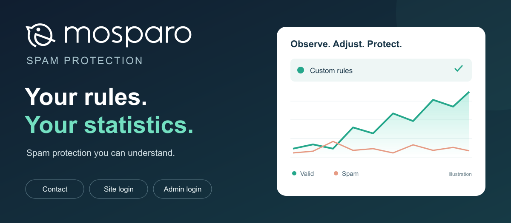

# mosparo

[English](README.md) · [Français](README.fr.md) · [Téléchargement](https://github.com/YGomiero/mosparo-joomla/releases/latest) · [Assistance](https://github.com/YGomiero/mosparo-joomla/issues)

**Des règles personnalisées, des statistiques pour les ajuster, et une protection des formulaires Joomla.**

> **Prérequis indispensable : mosparo doit déjà être installé, configuré et accessible.** Ce paquet est une intégration Joomla ; il n’installe pas le serveur mosparo. Préparer une instance auto-hébergée ou un service mosparo hébergé et un projet avec ses clés. [Installer mosparo](https://documentation.mosparo.io/docs/category/installation).

Ce paquet relie Joomla à votre instance [mosparo](https://mosparo.io). Il réunit le plugin **CAPTCHA – mosparo** pour le contact et le plugin **Système – mosparo : connexions** pour la page de connexion, les modules Connexion natifs et l’administration. Les règles, les soumissions et les statistiques se consultent dans mosparo.

Version **1.1.3** · Joomla **6.x**, PHP **8.3+** · Essais réalisés sur Joomla **6.2.0**, PHP **8.3.30**, mosparo **1.5.12** · Client PHP officiel **2.0.1**.

## Installer

1. Télécharger **pkg_mosparo-1.1.3.zip** dans la release ; le ZIP « Source code » de GitHub n’est pas installable dans Joomla.
2. Installer le paquet dans **Système → Installation → Extensions**.
3. Configurer et activer **CAPTCHA – mosparo** avec l’URL, l’UUID et les deux clés de votre projet. Ajouter le domaine du site aux hôtes autorisés de ce projet.
4. Choisir mosparo comme CAPTCHA dans les options du composant Contacts, puis essayer un contact.
5. Activer **Système – mosparo : connexions**, puis sa protection du site. Activer l’administration après un essai réussi, en gardant une session ouverte.

La protection des connexions est désactivée par défaut. Les réglages existants du plugin CAPTCHA sont conservés à la mise à niveau. Une sauvegarde reste nécessaire avant installation.

## Guides

- [Installation, réglages et dépannage](docs/installation.fr.md)
- [mosparo : règles, statistiques et comparaison avec Joomla](docs/mosparo.fr.md)
- [Architecture et développement / Architecture and development](docs/development.md)
- [Historique / Changelog](CHANGELOG.md)
- [Sécurité / Security](SECURITY.md)
- [Crédits et licences / Credits and licences](THIRD-PARTY.md)

## Mises à jour

Joomla suit le **paquet complet** grâce au serveur de mise à jour déclaré dans son manifeste. Chaque release fournit le ZIP, `update.xml` et `SHA256SUMS`. Le flux stable se trouve à [cette adresse](https://github.com/YGomiero/mosparo-joomla/releases/latest/download/update.xml). La mise à jour du serveur mosparo reste indépendante de celle de cette extension.

Une action GitHub teste, construit et publie ces fichiers à chaque nouveau tag stable. Une seconde gère le flux des releases publiées manuellement. [Procédure de publication](docs/development.md#release). La fiche JED, lorsqu’elle sera acceptée, restera à actualiser dans l’annuaire : ce flux assure les mises à jour dans Joomla, pas l’édition automatique de la fiche JED.

## Portée

La validation est effectuée côté serveur, avant l’authentification pour les connexions natives par mot de passe. Seul l’identifiant est transmis à mosparo pour ces connexions ; les mots de passe restent dans Joomla, même lorsque le bouton d’affichage du mot de passe est utilisé. Les clés d’accès, cookies « Se rappeler de moi », API et formulaires de connexion d’extensions tierces ne sont pas interceptés.

Le contact standard protège nom, e-mail, sujet et message. Des profils existent aussi pour l’inscription, le rappel d’identifiant et la demande de réinitialisation ; ils nécessitent une recette sur votre configuration. Les champs personnalisés et formulaires tiers demandent une intégration et des essais spécifiques. Ce paquet n’ajoute pas de tableau de statistiques dans Joomla.

Projet indépendant maintenu par Yann Gomiero. Il n’est ni publié ni approuvé par les équipes mosparo ou Joomla. Licence du code d’intégration : GPL-2.0-or-later. Les bibliothèques et le logo mosparo conservent leurs crédits et licences.
